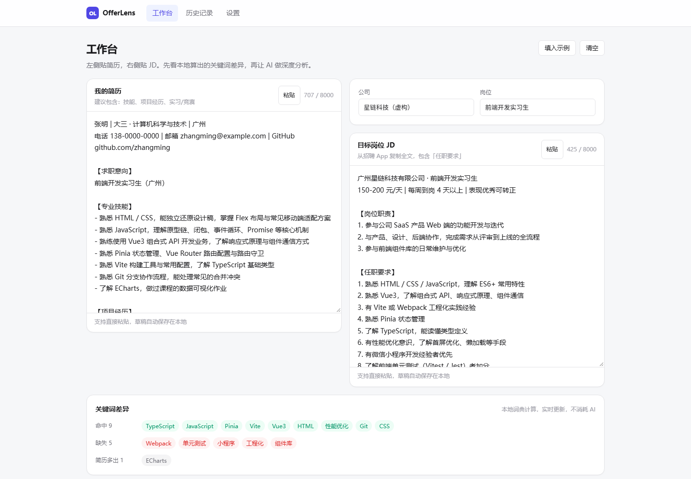
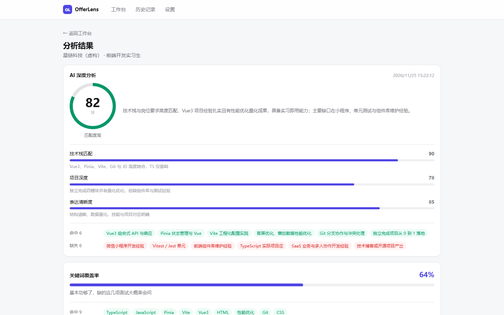
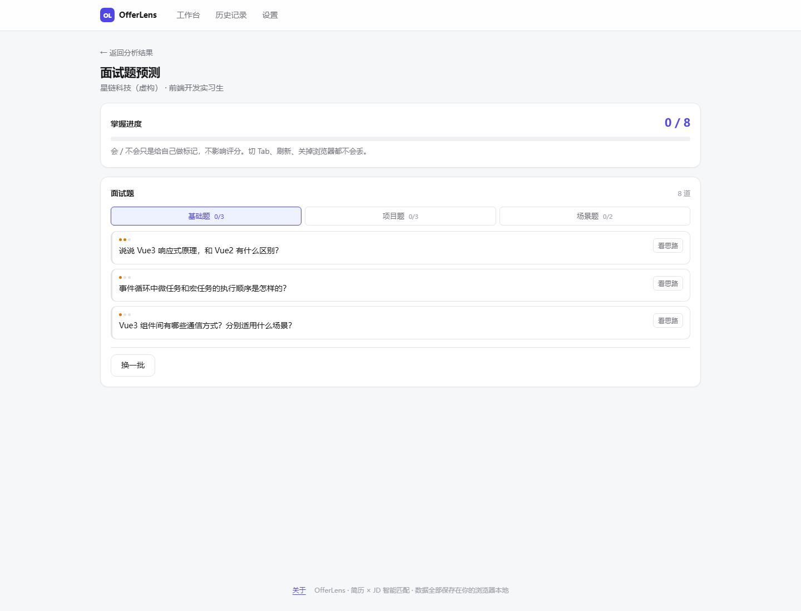

# OfferLens

**简历 × JD 智能匹配助手 —— 粘贴一份岗位描述，10 秒告诉你差在哪、怎么改、会被问什么。**

[](https://vuejs.org/)
[](https://www.typescriptlang.org/)
[](https://vitejs.dev/)
[](#license)

> 🔗 在线体验：**[offer-lens-lemon.vercel.app](https://offer-lens-lemon.vercel.app)**
>
> 无需注册，打开即用。AI 功能走服务端代理，Key 不在前端（见[部署](#部署)）。

<p align="center">
  
  
</p>
<p align="center"><sub>左：输入 —— 关键词差异纯前端算，不耗 token　｜　右：输出 —— 总分 + 维度 + 覆盖率</sub></p>

<p align="center">
  
</p>

---

## 为什么做这个

找实习的时候，最耗时的不是投递，是**对着 JD 反复改简历**：

- JD 写「熟悉 Webpack 构建优化」，我简历写「熟悉前端工程化」，这算不算命中？
- 一晚上改 3 个版本，第二天分不清哪版投了哪家
- 改完不知道面试官会从哪句话里往下挖

招聘 App 自带的简历诊断要么收费、要么只给一个 76 分的模糊结论，不说**具体哪一句该怎么改**。

所以做了这个：**输入 → 差距清单 → 逐句改写 → 预测面试题**，一条链路走完。它不是演示项目，是我自己投简历时真的在用的东西。

## 功能

| | 功能 | 说明 |
|---|---|---|
| 📋 | **双栏输入** | 左简历右 JD，本地自动存草稿，刷新不丢 |
| 🔍 | **关键词差异** | 内置前端技能词典，纯前端算出命中 / 缺失，零 token 成本、< 50ms |
| 📊 | **匹配度评分** | 0-100 总分 + 技能/经验/项目三维度分 + 一句话点评 |
| ✍️ | **逐段改写** | 简历按段落拆，输出「原句 → 建议句 → 为什么这么改」 |
| 🎯 | **面试题预测** | 按 JD 生成 8 道题，分基础/项目/场景，附答题思路 |
| 🗂 | **本地历史** | IndexedDB 存储，可回看、可标记已投递 |
| ⚡ | **流式输出** | AI 内容逐字出现，随时可中断 |

## 技术栈

**Vue 3**（组合式 API）· **TypeScript** · **Vite 5** · **Vue Router 4** · **Pinia** · 原生 CSS · IndexedDB · Vercel Edge Function · DeepSeek API

无 UI 组件库、无图表库、无 Axios —— 界面和环形图表都是手写的，理由见[设计取舍](#设计取舍与「非目标」)。

## 核心实现

### 1. 手写 SSE 流式解析

没用 `EventSource`，因为它只支持 GET，带不了 body。改用 `fetch` + `ReadableStream` 手动解析，需要处理三个真实问题：

```ts
const reader = res.body.getReader()
const decoder = new TextDecoder()
let buffer = ''

while (true) {
  const { done, value } = await reader.read()
  if (done) break
  buffer += decoder.decode(value, { stream: true })  // ← 中文多字节可能被切开

  const lines = buffer.split('\n')
  buffer = lines.pop() ?? ''   // ← 半包：最后一段可能不完整，留到下一轮

  for (const line of lines) {
    if (!line.trim().startsWith('data:')) continue
    const data = line.trim().slice(5).trim()
    if (data === '[DONE]') continue
    try {
      const delta = JSON.parse(data).choices?.[0]?.delta?.content ?? ''
      if (delta) onDelta(delta)
    } catch { /* 单分片坏了不影响整体 */ }
  }
}
```

- **半包问题**：一个 SSE 事件可能被拆进两个 TCP 包，不缓冲就会 JSON 解析失败
- **中文乱码**：UTF-8 下一个汉字 3 字节，`TextDecoder` 必须带 `{ stream: true }`
- **中止处理**：`AbortError` 要单独判断，否则用户点「停止」会看到报错

### 2. 用 rAF 合并高频更新

流式输出时 token 是一小片一小片到的，每来一片就重算一次列表、换一次数组引用，等于同一个 16ms 里算了好几遍，浏览器只会把最后一遍画出来。

现在用 `requestAnimationFrame` 把一帧内的多次触发合并成一次（`composables/useRAFBuffer.ts`）：

```ts
function schedule() {
  if (rafId) return                 // 这一帧已经排上了，再调也没用
  rafId = requestAnimationFrame(() => {
    rafId = 0                       // 先清零再执行，否则 flush 内部的再次 schedule 会被吞掉
    flush()
  })
}
```

**收尾必须自己补一次**：流结束时最后一帧可能还没到，要在 `finally` 里 `cancel()` 之后同步 `flush()` 一次，否则最后 1–2 条结果会丢。

**实测结论**（Chrome longtask API，本地开发环境，同一份简历 + JD）：

| 指标 | 接入前 | 接入后 |
|---|---|---|
| 主线程 > 50ms 长任务 | 0 个 | 0 个 |
| 单次流式耗时（模型生成，仅参考） | 29.3s | 12.0s |

长任务两边都是 0，说明**这个数据量下渲染本来就不是瓶颈**，所以这次改动测不出收益。它的价值在别处：token 速率更高时兜底，以及保证同一帧不会重复渲染。

耗时那一行是模型输出长度与网络波动造成的，**不属于优化效果**，写在这里只是为了说明为什么不能拿它当指标。


### 3. 「本地词典 + AI」双路关键词抽取

技能名是有限可枚举的，用 AI 抽既慢（2-3s）、又花钱、结果还不稳定。所以本地算，AI 只负责语义层面的改写建议。

实现里要处理三个坑：

```ts
// ① 长短词遮挡：JavaScript 不能被 Java 命中 → 按词长倒序 + 标记已占用区间
const dict = [...SKILLS].sort((a, b) => b.length - a.length)

// ② 词边界：Git 不该在 Digital 里命中
const boundaryOk = !isWordChar(text[idx - 1]) && !isWordChar(text[idx + len])

// ③ 大小写与空格：vue3 / VUE3 / Vue 3 都要命中 → 统一 normalize 再匹配
```

### 4. AI 返回 JSON 的三层兜底

模型会包 ```json 代码块、会在 JSON 前面加「好的，以下是分析结果」、会少个括号。解析失败就白屏是绝对不能接受的：

```ts
s = s.replace(/^```(?:json)?\s*/i, '').replace(/```\s*$/, '').trim()  // 去代码块
const start = s.search(/[[{]/)                                        // 截取 JSON 主体
const end = s.lastIndexOf(s[start] === '{' ? '}' : ']')
try { return JSON.parse(s.slice(start, end + 1)) }
catch { return null }                                                 // 降级纯文本展示
```

### 5. 为什么需要一层后端

AI Key 不能放前端——打包后的 JS 里明文可读，任何人 F12 就能白嫖额度；而且厂商不允许浏览器跨域直连。所以加了一个 **20 行的 Vercel Edge Function** 只做转发：

```ts
// api/chat.ts —— 不碰业务，只透传流
return new Response(upstream.body, {
  headers: { 'Content-Type': 'text/event-stream', 'Cache-Control': 'no-cache' },
})
```

用 Edge Runtime 是因为冷启动约 50ms（Node 要 500ms+），而代理层没有 Node API 依赖。

## 快速开始

```bash
git clone https://github.com/<your-name>/offer-lens.git
cd offer-lens
npm install

# 配置 AI Key（不要加 VITE_ 前缀，否则会被打进前端产物）
cp .env.example .env.local
# 填入 DEEPSEEK_API_KEY=sk-xxxx
```

```bash
# 开发（必须用 vercel dev，否则 /api 路由不生效）
npm i -g vercel
vercel dev

# 仅前端调试（AI 功能不可用）
npm run dev
```

## 目录结构

```
offer-lens/
├─ api/chat.ts                # 唯一后端：AI 流式代理（Key 只在服务端）
├─ src/
│  ├─ composables/            # 一个能力一个文件
│  │  ├─ useAIStream.ts       # SSE 流式请求 + 解析 + 中止
│  │  ├─ useRAFBuffer.ts      # 高频更新按帧合并
│  │  ├─ useKeywordExtract.ts # 本地词典抽取（不花 token）
│  │  ├─ useScore.ts          # 匹配度评分（非流式）
│  │  ├─ useRewrite.ts        # 逐段改写建议（流式）
│  │  ├─ useQuestions.ts      # 面试题预测（非流式）
│  │  └─ useLocalDB.ts        # IndexedDB 封装
│  ├─ utils/
│  │  ├─ extractObjects.ts    # 从半包流里捞出完整 JSON 对象
│  │  └─ safeParseJSON.ts     # AI 返回 JSON 的容错解析
│  ├─ prompts/                # prompt 单独管理，便于迭代
│  ├─ stores/                 # 只放跨路由共享的状态
│  ├─ styles/                 # 设计令牌 + 全局样式
│  ├─ components/
│  │  ├─ common/              # 复用组件（评分环 / 维度条 / 状态块等）
│  │  └─ layout/              # 页面框架
│  └─ views/                  # 5 个页面，全部路由懒加载
└─ docs/                      # 需求 / 技术方案 / 排期 / 进度台账 / 踩坑复盘
```

## 部署

线上地址：**https://offer-lens-lemon.vercel.app**

架构是「静态前端 + 一个 Edge Function」：`npm run build` 出 `dist/`，`api/chat.ts` 单独跑在 Edge Runtime 上，共用 `vercel.json` 里的 SPA 回落规则。

项目已接 GitHub（`main` 分支），**push 即自动部署**，不需要本地装 Vercel CLI。首次手动部署或换环境时，顺序不能反：

```bash
# 1. 先把 Key 配上（本地 .env 不会被上传，线上读不到就是 500）
npx vercel env add DEEPSEEK_API_KEY production

# 2. 再部署
npx vercel --prod
```

`.env` 已在 `.gitignore` 里，只在本地 `npm run dev` 时被读取；线上读的是 Vercel 项目的环境变量。
**Key 不能加 `VITE_` 前缀** —— 加了会被 Vite 打进前端产物，F12 就能看到。

### 常见问题

| 现象 | 原因 |
|---|---|
| 页面能打开，点分析报 500 + `missing_api_key` | 线上没配 `DEEPSEEK_API_KEY`，或配完没重新部署 |
| 报 401 | Key 失效或额度用完（DeepSeek 控制台可查） |
| 刷新 `/result/xxx` 404 | `vercel.json` 的 rewrite 被删了，SPA 需要把非静态路径回落到 `index.html` |
| 本地 `vercel dev` 卡在 `Retrieving project…` | 所在网络访问不到 `api.vercel.com`（校园网常见），与代码无关 |

> 本地开发不需要 Vercel CLI：`npm run dev` 时 `vite.config.ts` 里挂了一个中间件，直接复用 `api/chat.ts` 的 handler，逻辑只有一份。

> 本项目按「文档先行」开发，`docs/` 里保留了完整的需求文档、技术选型说明和 4 周排期，可以直接看出每个决策的来龙去脉。

## 设计取舍与「非目标」

刻意**没有**做的事，以及原因：

| 没做 | 原因 |
|---|---|
| 账号体系 / 登录 | 没有多端同步需求，本地存储足够。做账号要 2 周，收益是「换浏览器能看到历史」，不值 |
| 简历 PDF 上传解析 | PDF 排版千奇百怪，解析成本远超收益，让用户粘贴文本更稳 |
| 后端数据库 | 前端无状态架构，AI Key 才需要服务端 |
| RAG / 向量检索 | 简历+JD 才几千字，直接塞进 context 就够，上向量库是过度设计 |
| UI 组件库 / 图表库 | 界面元素很少，一个环形分数用 `conic-gradient` 就够，为它引 1MB 不划算 |
| 列表虚拟滚动 | 改写结果最多 10 段，为 10 条数据上虚拟列表是炫技 |
| 字符级文本 diff | `O(n·m)` 在大文本上会卡，做段落级对齐就够用 |

> 判断一个功能该不该做，标准是「有没有真实用户会因此受益」。这套取舍思路比堆功能更能说明工程判断力。

## Roadmap

- [x] 核心链路：输入 → 评分 → 改写 → 面试题
- [x] 流式输出与中断
- [x] 本地历史记录
- [ ] 多份简历版本管理与版本 diff
- [ ] 关键词覆盖率雷达图
- [ ] 投递台账（公司 / 时间 / 状态 / 复盘笔记）
- [ ] 导出 Markdown 格式改写结果

## License

MIT
